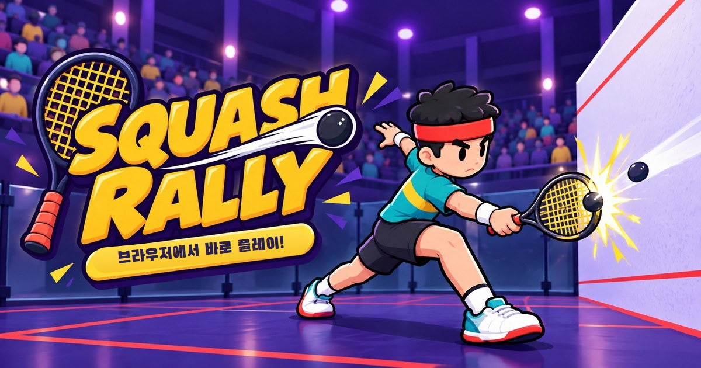

# SQUASH RALLY

링크 하나로 바로 치는 3D 스쿼시 웹게임. 설치·로그인 없이 데스크톱 브라우저에서 플레이합니다.

**▶ 플레이: https://ovencub.github.io/squash-rally/**



## 조작

| 입력 | 동작 |
|---|---|
| `W` `A` `S` `D` / 방향키 | 이동 |
| 마우스 **우클릭** | 포핸드 — 공이 캐릭터 **오른쪽** 절반에 있을 때 |
| 마우스 **좌클릭** | 백핸드 — 공이 캐릭터 **왼쪽** 절반에 있을 때 |
| 커서 위치 | 공을 보낼 방향 |
| `Esc` | 일시정지 |

- 캐릭터 주변 원이 타격 범위입니다. 공이 **노란 점선 원**(범위의 절반 지점) 위에 있을 때, 타이밍까지 맞으면 **PERFECT** — 가장 빠르고 낮고 깊게 날아갑니다.
- 바닥의 빨간 링은 공이 칠 만한 높이로 내려올 곳입니다.
- 내 드라이브는 항상 유효하게 앞벽에 들어갑니다. 승부는 **위치 잡기와 타이밍**입니다.

## 모드

- **1인 모드**: 혼자 벽치기. 연속 랠리(콤보) 기록 도전, 난이도별 최고 기록 저장.
- **AI 대전**: PAR 11점제, 10:10부터 2점 차, 3전 2선승. 서브는 클릭.
- **난이도**: 쉬움 / 보통 / 어려움 — 코트가 좁아지고 게임 진행 속도가 빨라집니다 (1.0× / 1.15× / 1.35×).

## 개발

```bash
npm install
npm run dev        # http://localhost:5173/squash-rally/
npm test           # 룰·물리·스윙 단위 테스트 (Vitest)
npm run e2e        # 브라우저 E2E (Playwright, 개발 서버)
npm run e2e:prod   # 배포 빌드로 크롬·파이어폭스·웹킷 스모크 테스트
npm run build
```

- 스택: TypeScript + Vite + Three.js, 물리엔진 없이 직접 구현한 탄도 물리(240Hz 고정 스텝, 스윕 충돌)
- 모든 튜닝값: `src/config/tuning.ts` · 게임 안에서 `` ` `` 키로 디버그 패널
- 설계 문서: `docs/01_기획서_설계의도.md` → `spec.md` · 작업 규칙: `CLAUDE.md`
- `main` 브랜치에 push하면 GitHub Actions가 GitHub Pages로 배포합니다.

## 크레딧

- 효과음 일부: [Kenney](https://kenney.nl) (CC0) — 전체 목록과 합성음 설명은 [`assets/sfx/CREDITS.md`](assets/sfx/CREDITS.md)
- 폰트: Black Han Sans, Noto Sans KR (Google Fonts, SIL Open Font License)
- 스폰서 보드의 이름·로고는 모두 가상입니다.
